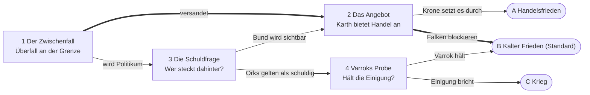

# Subplot Karth (was die Welt erlebt)

Stand: 2026-10-22. Gilt zusammen mit `docs/lore/story.md` (Kanon) und `docs/lore/fraktionen.md` (Akteure). Der Subplot ist Hintergrund: Die Gruppe reist ihren eigenen Weg und greift spät oder nie ein. Die Welt läuft in vier Phasen von selbst durch. Die Beispielkampagnen aus der Datenbank spielen dafür keine Rolle.

## Grundlage
- Die Orks von Karth wollen wirklich Frieden und Wohlstand. Sie sehen, wie Weidenmark und Dornmark aufblühen (Städte, Straßen, Handel, Fortschritt), und wollen das auch. Sie werden eine junge Nation mit Hauptstadt, Gesetzen und Handel.
- Weidenmark hält sie trotzdem für Barbaren. Dieses Missverständnis treibt den Subplot, nicht ein Bösewicht.
- Es gibt keinen Krieg.
- Der Graue Bund bleibt ein offener Faden für später und hat nur ein Ziel: Macht und Geld durch Angst vor Karth.
- **Standardverlauf ohne die PCs: der kalte Frieden.** Alles bleibt angespannt, nichts löst sich, Soldaten sind überall. Wenn die Gruppe später eingreift, kann sie das Ende kippen.

## Der Baum
Vier Knoten, drei Enden. Fett gesetzt ist der Standardverlauf.

| Phase | Knoten | Frage | Wer drückt |
|---|---|---|---|
| 1 Aufbruch | 1 Der Zwischenfall | Goblins aus Stamm Maladûk überfallen eine Karawane oder ein Grenzdorf, oder der Bund inszeniert es. Versandet es oder wird es zum Politikum? | Maladûk, Bund, Falken |
| 2 Reibung | 2 Das Angebot | Karth bietet Handel an. Setzt die Krone das Abkommen durch oder blockieren die Falken? | Krone und friedliche Hanse gegen die Falken |
| 2 Reibung | 3 Die Schuldfrage | Wer wird verantwortlich gemacht? Bleibt der Bund verborgen oder wird er sichtbar? | Bund (Gerüchte), Falken, Hanse |
| 3 Zerreißprobe | 4 Varroks Probe | Hält die Einigung dem Druck stand, vor allem von Maladûk und Gorrash? | Varrok, Maladûk, Gorrash |

## Die drei Enden
- **A Handelsfrieden:** Karth und Weidenmark schließen ein Abkommen. Karawanen laufen, Orkhändler stehen auf den Märkten, Karth baut seine erste Stadt. Der Bund bleibt im Schatten.
- **B Kalter Frieden (Standard):** Kein Krieg, aber Misstrauen. Soldaten an den Straßen, Kontrollpunkte, gedrosselter Handel. Karth wächst trotzdem weiter. Der Bund ist unentdeckt, die Lage bleibt offen für später.
- **C Krieg:** Nur wenn alles schiefgeht. Varroks Einigung zerfällt, ein Stamm greift an, Weidenmark rüstet auf. Das Ende, das niemand will und von dem Falken und Bund am Ende profitieren.

## Was die Gruppe sieht
| Phase | Was in Karth und im Land passiert | Was die Gruppe mitbekommt |
|---|---|---|
| 1 Aufbruch | Karth zeigt sich als junge Nation: Gesandte, ein Handelsangebot, die Stämme bauen ihr Hauptlager aus. | Gerüchte über die geeinten Orks, erste Soldaten an den Königsstraßen, neugierige Händler, ein Ausrufer mit dem neuesten Klatsch. |
| 2 Reibung | Ein Zwischenfall an der Grenze. Bund und Falken nutzen ihn, die Krone will beruhigen. | Kontrollpunkte, neue Zölle, Plakate zur Wachsamkeit, steigende Preise, Streit in Schenken, Werber für die Grenzwache. |
| 3 Zerreißprobe | Karth baut Straßen und Gesetze. Der Druck auf Varrok von Stämmen wie Maladûk und Gorrash wächst. | Marschbefehle, Hamsterkäufe, Händler, die umkehren, Meldungen der Karawanengilde über Überfälle. |
| 4 Ergebnis | Eines der drei Enden. Ohne PCs der kalte Frieden. | A: Orkhändler und Karawanen. B: Festungen, kalte Blicke, Soldaten überall. C: Mobilmachung. |

## Offene Punkte
- Nachfolge der Krone: ungeklärt lassen oder festlegen?
- Wie weit sollen die Phasen an Kampagnenzeit gebunden sein (Monate) oder nur nach Ermessen der SL laufen?
- Soll der Bund später (Kampagne 2) ein eigener Plot werden?
